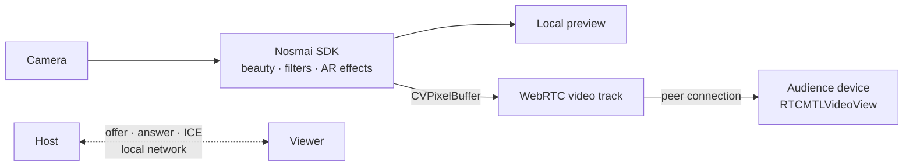

# Nosmai × WebRTC — iOS Live Streaming Quickstart

A minimal iOS sample that shows how to broadcast a live stream with **Nosmai** beauty, filters and AR effects over plain **WebRTC**.

Nosmai runs the camera and renders the effects on the host's device. Each processed frame is fed into a WebRTC video track, so viewers receive exactly what the host sees — no extra work is needed on the audience side.


## Features

- **Go live as a host** with the Nosmai camera and effects pipeline
- **Watch as an audience member** on a second device
- **Beauty controls** — skin smoothing, whitening, face slimming, eye enlargement, sharpening
- **Cloud filters and AR effects** — browsed with thumbnails, downloaded on demand, applied in one tap
- **Front / back camera switch**
- **Live FPS counter** for both host (frames sent) and audience (frames rendered)
- **No streaming account or server needed** — the only key is your Nosmai API key

## How it works



1. The host creates a WebRTC video source with a plain capturer — no camera capturer, because Nosmai owns the camera.
2. Nosmai is initialised with your API key, attached to the preview view, and starts the camera.
3. Nosmai delivers every processed frame through `liveFrameStreamCallback`. The app wraps the `CVPixelBuffer` in an `RTCVideoFrame` and hands it to the video source.
4. When a viewer appears, the host creates a peer connection, adds its video and audio tracks, and sends an offer. The viewer answers, and both sides exchange ICE candidates.
5. The viewer renders the host's video track.

### About signaling

WebRTC connects two peers directly, but it does not say how they find each other and exchange the offer, answer and ICE candidates. That part is called **signaling**, and every WebRTC app has to bring its own.

To keep this sample runnable without any server, signaling goes over the **local network** using Apple's MultipeerConnectivity framework (`LocalSignaling.swift`): the host advertises a room, viewers on the same Wi-Fi find it and connect. This means:

- **Both phones must be on the same Wi-Fi network.**
- iOS asks each phone for permission to find devices on the local network the first time. It must be allowed.

In your own app, replace `LocalSignaling` with your signaling channel (for example a WebSocket to your backend) and add a TURN server so that phones on different networks can connect. Nothing else in the sample depends on how the messages travel.

## Requirements

| | |
|---|---|
| Xcode | 15 or later |
| iOS | 15.0 or later |
| Dependency manager | [CocoaPods](https://cocoapods.org) |
| Devices | Two physical iPhones on the same Wi-Fi — one to host, one to watch. The camera is not available in the simulator. |
| Accounts | A Nosmai API key |

## Getting started

### 1. Clone and install

```sh
git clone https://github.com/HashirYamin-dev/quickstart-nosmai-webRTC-livestreaming-example.git
cd quickstart-nosmai-webRTC-livestreaming-example
pod install
```

Open **`NosmaiWebRTCDemo.xcworkspace`** in Xcode (not the `.xcodeproj`).

### 2. Set your bundle identifier

In the target's **Signing & Capabilities** tab, select your team and set your own bundle identifier.

> **Important:** a Nosmai API key only works with the bundle identifier it was issued for. Create your key for the same bundle identifier you set here.

### 3. Add your Nosmai key

Create an API key for your bundle identifier in the Nosmai dashboard, then open `NosmaiWebRTCDemo/DemoConfig.swift` and replace the placeholder:

```swift
static let nosmaiAPIKey = "YOUR_NOSMAI_API_KEY"
static let roomName = "demo-room"
```

| Value | Description |
|---|---|
| `nosmaiAPIKey` | Your Nosmai API key. |
| `roomName` | Any room name. Host and audience must use the same one. |

### 4. Run

Connect both iPhones to the same Wi-Fi, then build and run on both.

1. On the first phone tap **Go Live (Host)** and allow camera, microphone and local network access.
2. On the second phone tap **Watch (Audience)** and allow local network access.
3. On the host, use the **Beauty**, **Filters** and **AR Effects** tabs — the audience sees the result in real time.

## Project structure

```
NosmaiWebRTCDemo/
├── DemoConfig.swift          Your Nosmai key and room name
├── HomeViewController.swift  Role selection: host or audience
├── LiveViewController.swift  Nosmai camera + WebRTC peer connections (the integration)
├── LocalSignaling.swift      Local-network signaling (replace with your own)
├── EffectsPanelView.swift    Beauty sliders, cloud filters and AR effects UI
├── AppDelegate.swift         App and scene setup
└── NosmaiWebRTCDemo-Bridging-Header.h   Exposes the Nosmai framework to Swift
```

## Integration walkthrough

All of the code below is taken from `LiveViewController.swift`.

**Create the tracks without a camera capturer** — Nosmai owns the camera, so the capturer is only a handle used to deliver frames:

```swift
let factory = RTCPeerConnectionFactory(encoderFactory: RTCDefaultVideoEncoderFactory(),
                                       decoderFactory: RTCDefaultVideoDecoderFactory())
let videoSource = factory.videoSource()
let videoCapturer = RTCVideoCapturer(delegate: videoSource)
let videoTrack = factory.videoTrack(with: videoSource, trackId: "video0")
```

**Start Nosmai and show the local preview:**

```swift
NosmaiCore.shared().initialize(withAPIKey: apiKey) { success, error in
    guard success, let camera = NosmaiCore.shared().camera else { return }
    camera.attach(to: previewView)
    camera.startCapture()
    NosmaiSDK.sharedInstance()?.startProcessing()
}
```

**Forward every processed frame to the video track:**

```swift
NosmaiCore.shared().liveFrameStreamCallback = { pixelBuffer, _ in
    let frame = RTCVideoFrame(buffer: RTCCVPixelBuffer(pixelBuffer: pixelBuffer),
                              rotation: ._0,
                              timeStampNs: Int64(CACurrentMediaTime() * 1_000_000_000))
    videoSource.capturer(videoCapturer, didCapture: frame)
}
```

**Offer the tracks to a viewer** (host):

```swift
let connection = factory.peerConnection(with: rtcConfig, constraints: constraints, delegate: self)
connection.add(videoTrack, streamIds: ["stream0"])
connection.add(audioTrack, streamIds: ["stream0"])
connection.offer(for: constraints) { offer, _ in
    connection.setLocalDescription(offer) { _ in
        signaling.send(["type": "offer", "sdp": offer.sdp], to: viewer)
    }
}
```

**Render the host's video** (audience):

```swift
func peerConnection(_ peerConnection: RTCPeerConnection, didAdd rtpReceiver: RTCRtpReceiver,
                    streams mediaStreams: [RTCMediaStream]) {
    guard let track = rtpReceiver.track as? RTCVideoTrack else { return }
    track.add(remoteVideoView) // an RTCMTLVideoView
}
```

**Apply effects** (`EffectsPanelView.swift`) — anything applied here is part of the frames sent over WebRTC:

```swift
let effects = NosmaiCore.shared().effects

// Beauty: values range from 0.0 to 1.0
effects?.applySkinSmoothing(0.6)
effects?.applyFaceSlimming(0.3)

// Cloud filters and AR effects
effects?.downloadCloudFilter(filterId, progress: nil) { success, _, _ in
    if success { effects?.applyCloudFilter(filterId, completion: nil) }
}
```

When listing cloud filters with `getCloudFilters(with:completion:)`, use each item's `filterId` value to download and apply it.

## Troubleshooting

| Symptom | Likely cause |
|---|---|
| The home screen says a key is not set | The placeholder is still present in `DemoConfig.swift`. |
| `Nosmai init failed` | The API key is wrong, or the app's bundle identifier does not match the one the key was issued for. |
| The audience stays on "Looking for host on this Wi-Fi…" | The phones are on different networks, local network access was denied (enable it in Settings → Privacy & Security → Local Network), or the two phones use different room names. |
| "Connection failed" | The network blocks direct connections between devices (common on guest and corporate Wi-Fi). Try another network or a personal hotspot. |
| A tab shows "not enabled for this Nosmai license" | Beauty or cloud filters are not part of your Nosmai plan. |
| A filter fails to download | The filter is not included in your Nosmai plan, or the device is offline. |
| Build fails with a missing `Pods` error | Run `pod install` and open the `.xcworkspace`. |

## Going to production

This sample is intentionally small. Before shipping your own app:

- **Use your own signaling.** Replace `LocalSignaling` with a channel that works over the internet, such as a WebSocket to your backend.
- **Add a TURN server.** The sample only configures a public STUN server, which is enough on one network but not across most mobile and corporate networks.
- **Plan for scale.** Here the host sends a separate stream to every viewer, which suits a handful of viewers. Larger audiences need a media server (SFU).
- **Handle interruptions** such as phone calls, app backgrounding and network changes according to your product's needs.

## Dependencies

| Pod | Version |
|---|---|
| `NosmaiCameraSDK` | 3.0.7 |
| `WebRTC-SDK` | 144.7559.09 |
